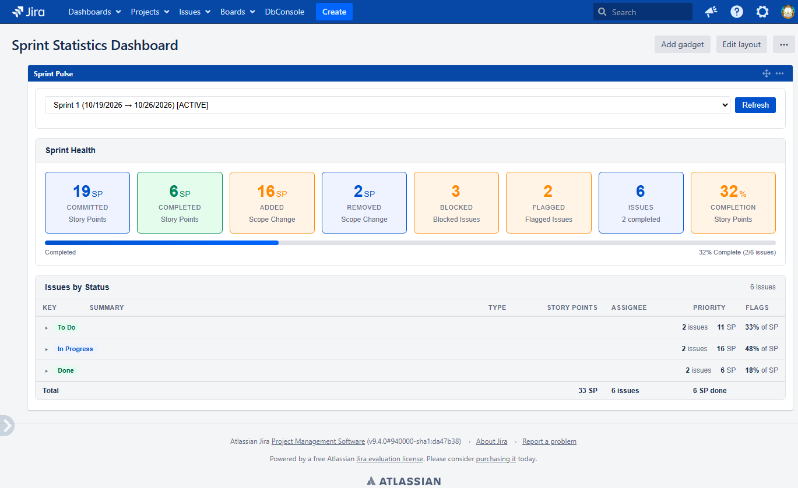

# Sprint Pulse

A Jira Server/Data Center dashboard gadget that combines the ideas of **Sprint Health** and **Sprint Statistics** into a single view: sprint health metrics at the top, and all sprint issues grouped by status with story points below.



## Features

- **Sprint picker** with dates and state (active, closed, future).
- **Health summary cards** for:
  - Committed story points
  - Completed story points
  - Story points added and removed during the sprint (scope change)
  - Blocked and flagged issue counts
  - Total/completed issue counts
  - Story-point completion percentage with a progress bar
- **Issues by status**, grouped and collapsible, showing key, summary, type, story points, assignee, priority, and blocked/flagged indicators.
- **Per-group totals** and a sprint summary row (total SP, issue count, completed SP).
- **Blocked/flagged detection** from issue links, custom fields, and labels.
- **Permission-aware**: all queries run as the logged-in user, so only issues that user can see are returned.
- Read-only: no Jira data is modified.

## Requirements

- Jira Software 9.4.0 (the plugin is built against this version)
- JDK 11
- Maven 3.8+
- A Jira project using sprints (Jira Software) and, ideally, a numeric Story Points field

## Build

```bash
cd my-jira-gadget
mvn package
```

The installable plugin is written to `my-jira-gadget/target/sprint-pulse-1.0.0-SNAPSHOT.jar` (an OBR file is also generated).

Run a local Jira instance with the plugin installed:

```bash
mvn jira:run
```

Jira starts at <http://localhost:2990/jira> with `admin` / `admin`. Use `mvn jira:debug` to start it in debug mode. The first run can take a while because the Jira distribution is downloaded and initialized.

## Installation

1. Build the plugin (see above).
2. In Jira, go to **Administration > Manage apps** (or **Apps > Manage apps**).
3. Choose **Upload app** and select `target/sprint-pulse-1.0.0-SNAPSHOT.jar`.
4. Wait for the plugin to install and enable.

### Manual/offline alternative

Copy the JAR into `<jira-home>/plugins/installed-plugins/` and restart Jira.

## Usage

1. Open or create a dashboard and choose **Add gadget**.
2. Search for **Sprint Pulse** and add it.
3. Optionally open the gadget's edit/configuration dialog and set a **Board ID** to limit the sprint list to a single board.
4. Select a sprint from the dropdown. The gadget loads health metrics and issues automatically.
5. Click **Refresh** to reload the selected sprint.

The selected sprint is saved as a gadget preference. Other preferences (shown in the configuration dialog) include:

| Preference | Default | Purpose |
| --- | --- | --- |
| Sprint | none | Sprint to display |
| Board ID | empty | Filter available sprints to one rapid view/board |
| Show Health Summary | `true` | Show or hide the health metric cards |
| Show Issues Table | `true` | Show or hide the issues table |
| Group by Status | `true` | Group issues by workflow status (grouping is currently always applied) |

### Selecting story points

The gadget uses the first custom field named **Story Points** or **Story Point Estimate**. If neither exists, it falls back to the first numeric (`float`) custom field. Make sure the field is on the issues in the sprint, otherwise story-point totals will be zero.

### How health metrics are calculated

- **Committed**: story points currently in the sprint, minus points added after sprint start, plus points removed from the sprint.
- **Completed**: story points on issues whose status category is **Done**.
- **Added/Removed**: read from the GreenHopper sprint report when available; issue counts come from the report's added/punted issue lists.
- **Blocked**: issue has an issue link whose type name contains `block` or `imped`, or a populated custom field whose name contains `flag`, `impediment`, or `blocked`, or a `flagged`/`impediment` label.
- **Flagged**: a populated **Flagged** or **Impediment Flag** custom field, or a `flagged`/`impediment` label.

## REST API

The gadget is backed by a REST module at `/rest/sprint/1.0`.

| Method | Path | Query parameters | Description |
| --- | --- | --- | --- |
| `GET` | `/rest/sprint/1.0/sprints` | `boardId` (optional) | List sprints visible to the current user |
| `GET` | `/rest/sprint/1.0/data` | `sprintId` or `boardId` | Sprint, health metrics, and issues grouped by status |

Example:

```bash
curl -u user:token "https://jira.example.com/rest/sprint/1.0/data?sprintId=1"
```

Sprints are discovered by reading the GreenHopper **Sprint** custom field on issues visible to the current user (`sprint is not EMPTY`), because `SprintManager` is not exported as an OSGi service.

## Project structure

```
my-jira-gadget/
├── pom.xml
└── src/main/
    ├── java/com/garfieldArlene/jira/gadget/rest/SprintGadgetResource.java
    └── resources/
        ├── atlassian-plugin.xml
        ├── gadget/my-gadget.xml
        ├── gadget/gadget.properties
        └── META-INF/spring/plugin-context.xml
```

- `SprintGadgetResource.java` — REST endpoints, sprint discovery, health calculations, issue serialization.
- `my-gadget.xml` — gadget definition, preferences, styles, and client-side rendering.
- `atlassian-plugin.xml` — plugin descriptor (gadget and REST modules).

## Development notes

- QuickReload is enabled (`enableQuickReload`), so `mvn jira:run` picks up many changes without a restart. Changes to `atlassian-plugin.xml` or Spring wiring normally still require a restart.
- `cdp-verify.ps1` is a Windows PowerShell helper that uses the Chrome DevTools Protocol to open a dashboard in a running Jira instance, select sprint `1`, verify the health cards render, and save a screenshot:

  ```powershell
  ./cdp-verify.ps1 -Url "http://localhost:2990/jira/dashboards/10000" -OutFile "dash-health.png"
  ```

  Start Chrome/Edge with `--remote-debugging-port=9222` before running it.

## License

BSD 3-Clause. See [LICENSE](LICENSE).
